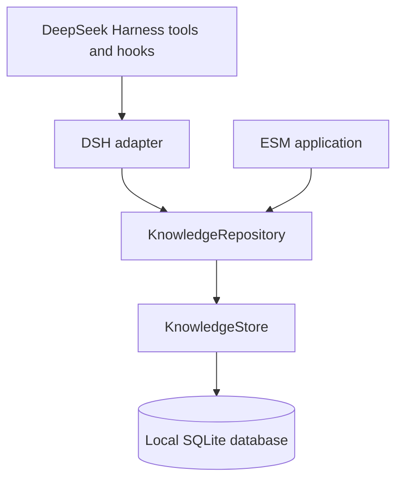

# DSH Knowledge Core

Persistent, evidence-backed project memory for AI coding agents.

Coding agents need project context that survives a conversation: architectural decisions, repository facts, and lessons worth keeping. DSH Knowledge Core stores that context in SQLite, with workspace/project scope, lifecycle status, and references to the evidence behind each entry.

Records can reference files, Git snapshots, or sessions. Deterministic retrieval selects relevant knowledge, while on-demand Git checks help identify evidence that has changed. Use the core as an ESM library or connect it to DeepSeek Harness through the optional adapter.

Your application decides what to store and how to use retrieved records. The core does not run an agent, call an LLM, provide semantic/vector search, or synchronize knowledge between machines. Automatic extraction and context injection are optional Harness adapter features.

[Install](#requirements-and-installation) · [Quick start](#quick-start) · [Harness integration](#deepseek-harness-integration) · [Configuration](#configuration-and-data-storage) · [Limitations and security](#limitations-and-security)

## Key features

- **Local storage:** SQLite persistence through `better-sqlite3`, with automatic schema migrations.
- **Scoped records:** Facts, decisions, and lessons organized by workspace and optional project, with file, Git, or session evidence.
- **Explicit lifecycle:** Create, update, verify, archive, and supersede records through the repository API.
- **Deterministic retrieval:** Ranked lexical matching with score explanations and conservative duplicate suppression; literal search is also available.
- **Git provenance and freshness:** Capture clean, committed file references and compare their snapshots against the current repository.
- **Knowledge health:** Inspect one record or a batch of up to 16 records without changing stored knowledge.
- **Optional candidate extraction:** Conservative rules extract candidates from direct user messages in Harness.
- **Harness tools and context:** Seven knowledge tools and bounded retrieval before agent steps.

## Requirements and installation

- Node.js 20+ and npm, on a Node major supported by `better-sqlite3`. The locked development/test tooling requires Node.js 20.19+ or 22.12+ on a supported major version.
- ESM imports: use a `.mjs` file or a project with `"type": "module"`. JavaScript and TypeScript declarations are included; there is no CommonJS `require` export.
- `better-sqlite3` is a native dependency; installation requires a compatible prebuilt binary or a working native build toolchain.
- Git is required for source installation and Git provenance/freshness checks, but not for basic storage and retrieval.

Install the library in your Node.js project:

```sh
npm install dsh-knowledge-core
```

If a prebuilt native binary is unavailable, compilation requires Python and platform C/C++ build tools: Visual Studio's C++ workload on Windows, Xcode Command Line Tools on macOS, or `make` and a compiler on Unix. See the [node-gyp prerequisites](https://github.com/nodejs/node-gyp#installation). A separate SQLite server is not required.

Use `npm view dsh-knowledge-core version engines` to inspect the release supplied by your registry. For a source checkout, see [Development](#development). A Harness runtime is not needed to use the core entry point.

## Quick start

Save this as `quick-start.mjs` in a project where the package is installed, then run `node quick-start.mjs`:

```js
import {
  KnowledgeRepository,
  KnowledgeStore,
  retrieveRelevantKnowledge,
} from "dsh-knowledge-core";

const store = new KnowledgeStore(".dsh-knowledge/knowledge.sqlite");
const repository = new KnowledgeRepository(store);
const scope = { workspace: process.cwd(), project: "payments" };

repository.create({
  type: "decision",
  content: "Store project knowledge in SQLite.",
  scope,
  evidence: [{
    type: "file",
    source: "quick-start.mjs",
    locator: "repository.create",
    timestamp: new Date().toISOString(),
  }],
});

const matches = retrieveRelevantKnowledge(
  repository,
  "project knowledge SQLite",
  { ...scope, limit: 4 },
);

console.log(matches.map(({ knowledge }) => knowledge.content));
store.close();
```

On a fresh database, this prints `[ 'Store project knowledge in SQLite.' ]`. The record persists in `.dsh-knowledge/knowledge.sqlite` after the store closes; each run creates another candidate. File evidence here points to the example you saved. It is caller-supplied metadata, not a file-content check or captured Git snapshot.

New records start as `candidate`. Explicit candidates, including this example, are eligible for ranked retrieval immediately; automatically extracted candidates require verification first. After reviewing a record, an application can mark it verified with `repository.update(id, { status: "verified" })`. Use `repository.archive(id)` to archive it, or `repository.supersede(id, replacementId)` to replace a verified record with another verified record in the same scope.

`repository.search(query, filters)` performs literal substring matching. `retrieveRelevantKnowledge()` returns ranked records with scores and explanations, includes workspace-wide knowledge alongside the selected project, and excludes archived/superseded records.

Pass scope filters to `repository.list()` and `repository.search()` explicitly: without filters they can return records across all workspaces, projects, and lifecycle states. For those methods, `project: null` selects workspace-wide records; omitting `project` does not filter projects. Ranked retrieval always requires a workspace and, without a project, selects only workspace-wide records.

The public core also exports `captureFileProvenance()`, `checkKnowledgeFreshness()`, `checkKnowledgeHealth()`, and `checkKnowledgeHealthBatch()`. Health and freshness checks take an explicit `workspaceDirectory`; storing file evidence alone does not capture Git provenance.

## Architecture



| Public entry point | Purpose |
| --- | --- |
| `dsh-knowledge-core` | Storage, repository, ranked retrieval, extraction helpers, Git inspection, health checks, and their TypeScript types. |
| `dsh-knowledge-core/plugin` | Cordis plugin with named `name`, `inject`, `Config`, and `apply` exports, plus a default plugin object. |

The core entry point works independently of the Harness adapter. Git inspection runs locally and does not fetch missing objects or contact remotes.

## DeepSeek Harness integration

The adapter targets Harness `0.2.0-rc.2`. Its optional peer requirements are `@deepseek-ai/dsh-agent`, `@deepseek-ai/dsh-llm`, `@deepseek-ai/dsh-session`, and `@deepseek-ai/dsh-tools` at exactly `0.2.0-rc.2`, plus `@deepseek-ai/cordis` `~4.0.4` and `@deepseek-ai/schemastery` `~3.18.4`. Use a matching DSH CLI/runtime, pnpm, and a configured profile. Compatibility with other Harness releases is not established.

The package exports the adapter at `dsh-knowledge-core/plugin`. Its `dsh.bundle.patch` points to [cordis.patch.yml](cordis.patch.yml), which retains the plugin ID `dsh-knowledge` and registration name `dsh-knowledge/plugin`. Install under the `dsh-knowledge` dependency alias so that registration resolves.

For an npm installation, replace `<profile>` with your profile name, such as `web`:

```sh
dsh plugin --profile <profile> add dsh-knowledge@npm:dsh-knowledge-core
```

For a built [local checkout](#development), replace the absolute path and profile name:

```sh
dsh plugin --profile <profile> add "dsh-knowledge@file:/absolute/path/to/dsh-knowledge-core"
```

Or install from the repository:

```sh
dsh plugin --profile <profile> add dsh-knowledge@github:Claven07/dsh-knowledge-core
```

Git installations build through `prepare`. If pnpm blocks required build scripts, review the packages and allow the exact build entries it reports in the profile's `pnpm-workspace.yaml` before retrying. See pnpm's [package aliases](https://pnpm.io/aliases) documentation for the dependency-name behavior.

Add an ID-targeted override to `<resolved DSH home>/profiles/<profile>/cordis.patch.yml` (by default `~/.dsh/profiles/<profile>/cordis.patch.yml`) to select a project and opt into extraction:

```yaml
- id: dsh-knowledge
  name: dsh-knowledge/plugin
  config:
    project: payments
    automaticExtraction: true
```

An override replaces the row's configuration, so include all settings you need to retain.

| Tool | Purpose |
| --- | --- |
| `knowledge_add` | Create a candidate with caller evidence and current-session evidence when available. |
| `knowledge_search` | Search stored content literally with scope and lifecycle filters. |
| `knowledge_list` | List records by scope, type, status, or creation origin. |
| `knowledge_get` | Read a record; `includeHealth: true` requests a live health check. |
| `knowledge_archive` | Archive a record in the selected scope. |
| `knowledge_check_freshness` | Compare Git-backed evidence in the active workspace/configured project. |
| `knowledge_health` | Check 1–16 IDs; `includeGuidance: true` adds advisory follow-up guidance. |

Before agent steps, the adapter retrieves at most four relevant records and injects up to 1,800 characters of quoted context. `knowledge_add` attempts Git provenance capture for clean, tracked file evidence when the requested workspace matches the active session.

## Configuration and data storage

All plugin settings are optional:

| Option | Default | Behavior |
| --- | --- | --- |
| `databasePath` | `<resolved DSH home>/knowledge/knowledge.sqlite` | SQLite file path; relative paths resolve against the process working directory. |
| `dshHome` | `DSH_HOME`, then `~/.dsh` | Override the Harness home used by the default database path. |
| `project` | No project label | Select the default project for tools, extraction, and pre-step retrieval. |
| `automaticExtraction` | `false` | Enable rule-based candidate extraction from direct user messages. |

With no home override, the plugin stores data in `~/.dsh/knowledge/knowledge.sqlite`. The core library requires an explicit database path; the quick start uses `.dsh-knowledge/knowledge.sqlite`. `KnowledgeStore` creates parent directories and supports `:memory:` for temporary databases. File-backed databases use SQLite WAL mode.

The adapter uses the active session's `cwd` as its workspace. Without a configured project, tools and pre-step retrieval use workspace-wide knowledge. Tools with a project parameter accept `project: null` to select workspace-wide records explicitly.

When extraction is enabled, bounded direct-user statements are processed after each turn. The detector stores the selected statement as a candidate with a compact session reference, rather than a full transcript. Extracted records have `creationOrigin: "automatic"`; inspect them with `knowledge_list`. They enter ranked retrieval only after explicit verification through the core API.

## Development

Clone the repository and install its development dependencies:

```sh
git clone https://github.com/Claven07/dsh-knowledge-core.git
cd dsh-knowledge-core
npm ci
npm run build
npm run typecheck
npm test
```

`npm ci` runs the package's `prepare` script, which builds with TypeScript; `npm run build` rebuilds explicitly. The build emits ESM JavaScript and TypeScript declarations in `dist/`. `npm run typecheck` checks `src/` without emitting files; `npm test` runs `tests/**/*.test.ts` with Vitest in a Node.js environment.

To use the built checkout in another Node.js project, run this from that project, replacing the path:

```sh
npm install "/absolute/path/to/dsh-knowledge-core"
```

## Limitations and security

- Retrieval uses local lexical matching and scans active records in scope. It does not use embeddings or semantic search.
- Extraction recognizes a narrow set of explicit statements and may miss useful knowledge. Assistant assertions and tool outcomes are not treated as evidence for automatic candidates; there is no model-facing verification tool.
- Health and freshness are on-demand evidence checks, not proof that a claim is true. `current` means checkable Git-backed snapshots match; `potentially_stale` signals a changed or missing source; `unverifiable` means evidence could not be checked. These checks do not alter lifecycle status or retrieval eligibility.
- Git checks are bounded snapshot comparisons. They do not follow renames or identify every historical edit. Missing objects, unsafe paths, configured filters, and hidden index state can make evidence unverifiable.
- Workspace scope uses the supplied string without filesystem canonicalization. Use consistent workspace paths and configure project labels explicitly. Data stays in the selected SQLite database; synchronization is not provided.
- Workspace/project scope is a filtering convention, not an access-control boundary. The trusted repository API can read across scopes. Protect access to the SQLite database and its WAL/SHM files and backups; exclude private project-memory files from version control.
- The Harness ingestion tool and automatic extraction reject common secret patterns, but this filtering is not comprehensive. The trusted core repository API does not scan secrets. Do not store credentials or sensitive personal data.
- Injected knowledge is quoted and labeled as untrusted data. Review stored content before relying on it or marking it verified.
- Harness places retrieved content in the agent's model context. Local SQLite storage does not prevent that content from being sent to the configured model provider.

## License

[MIT](LICENSE) — Copyright (c) 2026 Claven07.
